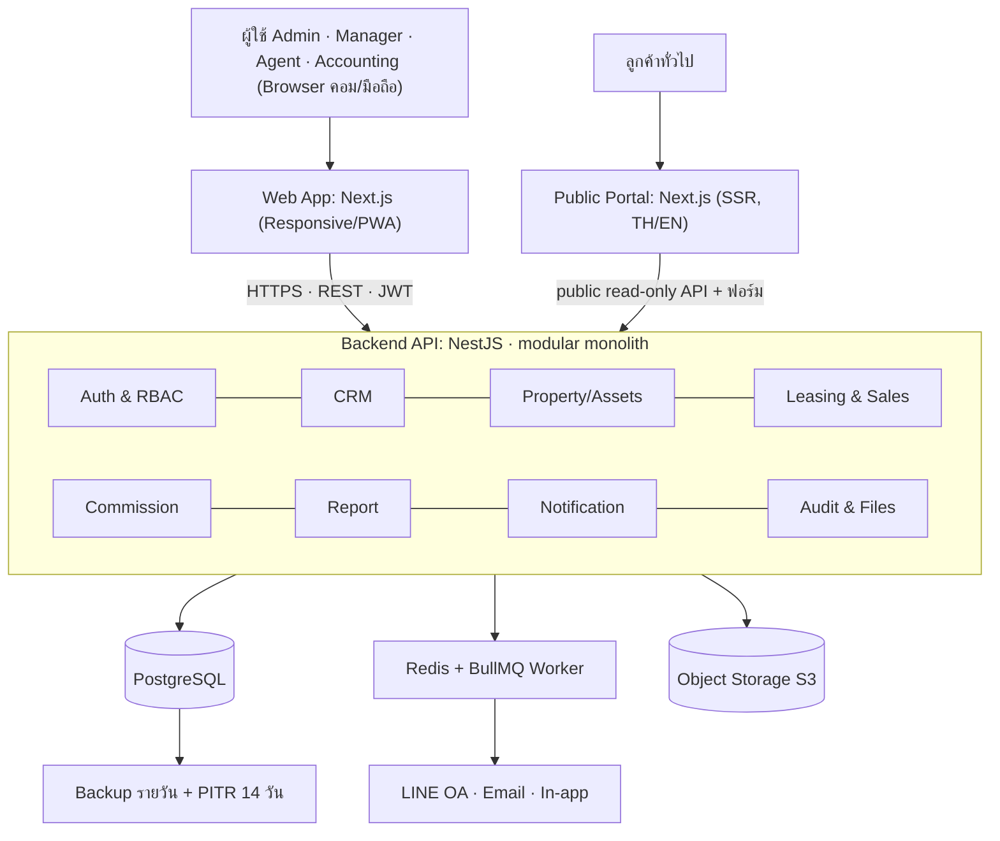

# Condo Rental Management System — วิเคราะห์ ออกแบบ และแผนพัฒนา

Oct 19, 2026 · @isara chootip

## 1. สรุปการวิเคราะห์ SRS

SRS ฉบับนี้ระบุข้อมูลที่ต้องเก็บได้ครบดี แต่ยังขาดกฎธุรกิจหลายจุดที่กระทบการออกแบบฐานข้อมูลและการคำนวณเงิน แนะนำให้ปิดคำถามด้านล่างก่อนเริ่มพัฒนา และประเมิน MVP ไว้ราว 22 สัปดาห์ด้วยทีม 5 คน

**ขอบเขตที่ SRS กำหนด:** ระบบเดียวรองรับ 2 ธุรกิจ คือห้องที่บริษัทเป็นเจ้าของ (Owner, รายได้ = ค่าเช่า) และห้องรับฝาก (Agent, รายได้ = ค่านายหน้า) ใช้ฐานลูกค้าและทีมงานร่วมกัน ครอบคลุม 6 ส่วน: ฐานข้อมูลกลาง, CRM ทีม, นัดดูห้อง, จองและสัญญา, คำนวณรายได้และค่านายหน้า, Dashboard และรายงาน

**จุดแข็งของ SRS**

- ระบุฟิลด์ของแต่ละตารางชัด ทำ ERD ได้ทันที
- มีตัวอย่างการแบ่งค่านายหน้าเป็นตัวเลข และกฎตรวจผลรวม 100%
- คิดเรื่อง Lead Ownership, Audit Log, การไม่เขียนทับประวัติสัญญา และ Archive แทนการลบไว้ตั้งแต่ต้น
- มีเกณฑ์ตรวจรับงาน (Acceptance Criteria) ที่วัดผลได้

**ช่องว่างและความกำกวมที่ต้องถามเจ้าของงาน**

- [ ] สถานะเจ้าของห้อง (2.1) ถูกตัดท้ายหลัง "ฝากเช่าแล้ว /" ค่าที่เหลือคืออะไร
- [ ] ห้องประเภท Owner ให้ Owner ID ชี้ไปที่ใคร เสนอให้สร้างระเบียน "บริษัท" เป็นเจ้าของ
- [ ] Lead ซ้ำ: ใครได้เป็นเจ้าของ (ผู้บันทึกก่อน หรือ Manager ตัดสิน) และสิทธิ์หมดอายุเมื่อไม่มีความเคลื่อนไหวกี่วัน
- [ ] ห้อง Owner ต้องออกใบแจ้งหนี้และติดตามค่าเช่ารายเดือนหรือไม่ SRS พูดถึง "ค่าเช่าที่รับจริง" แต่ไม่มีโมดูลเก็บค่าเช่า
- [ ] สูตร "เปอร์เซ็นต์ของค่าเช่ารวม" คิดจากค่าเช่าทั้งสัญญาหรือรายปี และสัญญาสั้นกว่า 12 เดือนคิดค่านายหน้าอย่างไร
- [ ] ต้องหักภาษี ณ ที่จ่าย 3% หรือคิด VAT ในค่านายหน้าและส่วนแบ่ง Agent หรือไม่ Agent เป็นพนักงานหรือฟรีแลนซ์
- [ ] ห้อง Agent ใครถือเงินประกัน (บริษัทหรือเจ้าของห้อง) และกฎยึดเงินจองเมื่อยกเลิก
- [ ] การต่อสัญญา, ยกเลิกก่อนกำหนด และการคืนค่านายหน้าเมื่อผู้เช่าออกก่อน
- [ ] สถานะ "ทำสัญญาแล้ว" กับ "ไม่ว่าง" ต่างกันอย่างไร และรับจองล่วงหน้าขณะห้องยังมีผู้เช่าได้หรือไม่
- [ ] Agent เห็นลูกค้าของคนอื่นได้แค่ไหน เบอร์โทรต้องปิดบางส่วนหรือไม่
- [ ] จำนวนผู้ใช้ ห้อง และ Lead ที่คาดไว้ รวมถึงงบ Hosting
- [ ] มีข้อมูลเดิม (Excel, Google Sheet) ที่ต้องย้ายเข้าระบบหรือไม่
- [ ] ต้องเชื่อมโปรแกรมบัญชีหรือเว็บประกาศเช่าหรือไม่ (SRS ไม่ได้ระบุ ถือว่าอยู่นอกขอบเขต)

ข้อสังเกตเพิ่ม: LINE Notify ปิดบริการไปแล้วเมื่อ 31 มี.ค. 2025 การแจ้งเตือนทาง LINE ต้องใช้ LINE Official Account ผ่าน Messaging API ซึ่งมีโควตาและค่าใช้จ่ายต่อข้อความ และข้อมูลผู้เช่า (สัญชาติ, เอกสาร) อยู่ภายใต้ PDPA

## 2. สถาปัตยกรรมและ Tech stack

แนะนำ Web App แบบ Responsive/PWA ตัวเดียวสำหรับทุกบทบาท ต่อกับ Backend แบบ modular monolith และ PostgreSQL ฐานเดียว เหมาะกับทีมเล็กและข้อมูลที่ผูกกันแน่น (ลูกค้า-ห้อง-สัญญา-เงิน) ซึ่งต้องการ transaction ข้ามโมดูล



แต่ละโมดูลมีขอบเขตชัดในโค้ด ถ้าภายหลังต้องแยกบริการออกไปก็ทำได้โดยไม่รื้อทั้งระบบ

| ชั้น | ตัวเลือกที่แนะนำ | เหตุผล | ทางเลือก |
| --- | --- | --- | --- |
| Frontend | Next.js + TypeScript, Tailwind, TanStack Table, FullCalendar | ตาราง/ปฏิทินพร้อมใช้, ใช้บนมือถือได้ดี, ติดตั้งเป็น PWA ได้ | Vue/Nuxt |
| Backend | NestJS (TypeScript), Prisma ORM | ภาษาเดียวกับ Frontend, โครงสร้างโมดูลชัด, มี guard สำหรับ RBAC | Laravel ถ้าทีมถนัด PHP |
| Database | PostgreSQL 16 | exclusion constraint กันจองซ้ำ, `pg_trgm` ค้นหา, JSONB สำหรับ audit | – |
| Jobs | Redis + BullMQ | แจ้งเตือนตามเวลา, ส่ง LINE/Email แบบ retry ได้ | Cron + ตารางคิว |
| Files | S3 หรือ S3-compatible | signed URL, lifecycle | Cloud storage ที่เทียบเท่า |
| Export | ExcelJS / CSV stream | ตามข้อ 4.5 ใน SRS | – |
| Hosting | Docker บน cloud region Singapore, managed PostgreSQL | latency ต่ำจากไทย, backup อัตโนมัติ | VPS ในไทยถ้างบจำกัด |
| DevOps | GitHub Actions, staging + production, Sentry | deploy อัตโนมัติ, ตามจับ error | – |

## 3. Data model

ใช้ PostgreSQL ฐานเดียว ประมาณ 25 ตาราง แยกห้อง Owner/Agent ด้วยฟิลด์ `property_type` บนตารางเดียว เพื่อให้ค้นหาและจับคู่ห้องได้จากที่เดียวตามที่ SRS ต้องการ

| กลุ่ม | ตาราง | เก็บอะไร / ความสัมพันธ์หลัก |
| --- | --- | --- |
| ผู้ใช้ | `users`, `teams`, `roles`, `permissions`, `user_roles` | บัญชีผู้ใช้ ทีม Agent บทบาท และสิทธิ์ที่ Admin เพิ่มเองได้ |
| เจ้าของห้อง | `owners` | ข้อมูลตาม 2.1 + `agent_id` ผู้ดูแล; มีระเบียน "บริษัท" 1 รายการสำหรับห้อง Owner |
| ทรัพย์สิน | `projects`, `properties`, `property_media`, `property_agents` | โครงการแยกเป็น master; `properties` ผูก `owner_id`, `project_id`; Agent หลายคนต่อห้องผ่าน `property_agents` (role) |
| สัญญาฝากเช่า | `listing_agreements` | วันเริ่ม-หมดสัญญาฝากเช่ากับเจ้าของห้อง อัตราค่านายหน้าที่ตกลง (เก็บเป็นประวัติ ไม่เขียนทับ) |
| Lead | `leads`, `lead_assignments`, `lead_collaborators` | ข้อมูลตาม 2.3; `lead_assignments` = ประวัติโอนเจ้าของ (จาก, ถึง, ผู้อนุมัติ, เหตุผล) |
| กิจกรรม | `activities`, `lead_offers` | โทร/แชต/โน้ต/ผลติดตาม + วันติดตามครั้งถัดไป; ห้องที่เสนอให้ลูกค้าแต่ละราย |
| นัดดูห้อง | `appointments`, `appointment_items` | นัด 1 ครั้งมีได้หลายห้อง; ช่วงเวลา `tstzrange` ใช้ตรวจนัดซ้อนของ Agent |
| จอง | `bookings` | ห้อง, ผู้เช่า, ค่าเช่า, เงินจอง/ประกัน/ล่วงหน้า, ช่วงวันที่ `daterange` |
| สัญญา | `contracts`, `contract_parties` | 1 สัญญา = 1 ระเบียนถาวร; ต่อสัญญา = ระเบียนใหม่ชี้ `previous_contract_id` |
| เงิน | `payments`, `rent_schedules`, `expenses` | รับเงินทุกประเภทพร้อมหลักฐาน; ตารางค่าเช่ารายเดือนสำหรับห้อง Owner; ค่าใช้จ่ายต่อห้อง |
| ค่านายหน้า | `commissions`, `commission_splits`, `commission_revisions`, `commission_payouts` | ยอดรวมต่อสัญญา, ส่วนแบ่งต่อบทบาท, ประวัติแก้หลังอนุมัติ, การจ่าย Agent |
| ระบบ | `files`, `notifications`, `notification_rules`, `audit_logs` | ไฟล์ทุกชนิด (S3 key), กล่องแจ้งเตือน, กฎแจ้งเตือน, ประวัติการแก้ไขแบบ append-only |

**หลักการออกแบบที่ใช้ทุกตาราง**

- เงินเก็บเป็น `numeric(14,2)` คำนวณเป็นสตางค์ ไม่ใช้ float
- ไม่ลบจริง: มี `archived_at` และ `archived_by` แทน
- ทุกตารางมี `created_by`, `updated_by`, `updated_at` และส่ง before/after เข้า `audit_logs`
- เบอร์โทรเก็บแบบ normalize (E.164) พร้อม index เพื่อตรวจซ้ำ แต่ไม่ใช้ unique constraint เพราะ SRS ให้ "แจ้งเตือน" ไม่ใช่ "ห้าม"
- ป้องกันจองซ้ำช่วงเวลาเดียวกันด้วย `EXCLUDE USING gist (property_id WITH =, period WITH &&)` บน bookings/contracts ที่ยังมีผล ระดับฐานข้อมูลจึงพลาดไม่ได้แม้มีคนกดพร้อมกัน
- ค้นหาชื่อ เบอร์ โครงการ เลขห้อง ด้วย `pg_trgm` รองรับพิมพ์ไม่ครบ

## 4. สถานะและการเปลี่ยนสถานะ

สถานะห้องควรเปลี่ยนอัตโนมัติจากเหตุการณ์จอง/สัญญา ไม่ให้ Agent แก้มือ เพื่อกันข้อมูลห้องว่างผิดซึ่งเป็นต้นเหตุจองซ้ำ ทุกการเปลี่ยนสถานะบันทึกผู้ทำและเวลาลง Audit Log

| เอนทิตี | ลำดับสถานะหลัก | สถานะออกนอกเส้นทาง | อะไรเป็นตัวเปลี่ยน |
| --- | --- | --- | --- |
| Lead | New Lead → Contacted → Qualified → นัดดูห้อง → เจรจา → จอง → ทำสัญญา → ปิดการเช่าสำเร็จ | Lost, ยกเลิก, ยังไม่ตัดสินใจ (กลับเข้าเส้นทางได้) | Agent เปลี่ยนเอง; สร้างนัด/จอง/สัญญาแล้วระบบเลื่อนให้อัตโนมัติ |
| ห้อง | ว่าง → มีนัดดู → อยู่ระหว่างเจรจา → จองแล้ว → ทำสัญญาแล้ว | ไม่ว่าง (ปิดชั่วคราว เช่น ซ่อม หรือหมดสัญญาฝากเช่า) | จองยืนยัน → จองแล้ว; เซ็นสัญญา → ทำสัญญาแล้ว; สัญญาสิ้นสุด/ยกเลิก → ว่าง |
| นัดหมาย | รอยืนยัน → ยืนยันแล้ว → นัดสำเร็จ | ยกเลิก, ลูกค้าไม่มาตามนัด, เลื่อนนัด (สร้างนัดใหม่ผูกนัดเดิม) | นัดสำเร็จแล้วบังคับให้บันทึกผลติดตาม (3.3) และวันติดตามครั้งถัดไป |
| จอง | รอชำระ → ชำระแล้ว → แปลงเป็นสัญญา | ยกเลิก (ระบุว่ายึด/คืนเงินจอง) | ชำระเงินจองแล้วจึงล็อกช่วงวันที่ของห้อง |
| สัญญา | ร่าง → รอลงนาม → มีผล → สิ้นสุด | ยกเลิกก่อนกำหนด, ต่อสัญญา (สร้างสัญญาใหม่) | วันหมดสัญญาสร้างงานแจ้งเตือน 90/60/30 วัน |
| ค่านายหน้า | รอคำนวณ → รอตรวจสอบ → อนุมัติแล้ว → รอรับเงินจากเจ้าของห้อง → ได้รับเงินแล้ว → รอจ่าย Agent → จ่ายแล้ว | ยกเลิกหรือปรับปรุงรายการ (สร้าง revision ใหม่) | สัญญามีผล → สร้างรายการรอคำนวณ; Accounting อนุมัติและบันทึกรับ/จ่ายพร้อมหลักฐาน |

ห้อง Owner ข้ามขั้น "รอรับเงินจากเจ้าของห้อง" ในค่านายหน้า เพราะบริษัทเป็นผู้จ่ายเอง

## 5. สิทธิ์ตามบทบาทและ Lead Ownership

สิทธิ์มี 2 ชั้น คือ "ทำอะไรได้" (permission ตามบทบาท) และ "เห็นข้อมูลไหนได้" (data scope) ตรวจที่ API ทุกครั้ง ไม่พึ่งการซ่อนปุ่มบนหน้าจอ ตารางนี้เป็นค่าเริ่มต้นที่เสนอ Admin ปรับเพิ่มได้

| ข้อมูล / การกระทำ | Admin | Manager | Agent | Accounting |
| --- | --- | --- | --- | --- |
| ผู้ใช้ บทบาท สิทธิ์ | จัดการ | ดูทีมตัวเอง | – | – |
| ทรัพย์สิน (ข้อมูลทั่วไป ราคา รูป) | จัดการ | จัดการ | ดูทั้งหมด, แก้ห้องที่รับผิดชอบ | ดู |
| ราคาต่ำสุดที่เสนอได้, ข้อมูลติดต่อเจ้าของห้อง | ดู/แก้ | ดู/แก้ | เฉพาะห้องที่รับผิดชอบ | ดู |
| Lead | ทั้งหมด | ทีมตัวเอง, มอบหมาย/โอน | ของตัวเอง + ที่ร่วมงาน; คนอื่นเห็นแค่ชื่อย่อและผู้ดูแล | – |
| นัดหมาย / ปฏิทินทีม | ทั้งหมด | ทีมตัวเอง | ของตัวเอง; ปฏิทินทีมเห็นแค่ช่วงไม่ว่าง | – |
| จอง / สัญญา | ทั้งหมด | สร้าง/อนุมัติ | สร้างของ Lead ตัวเอง | ดู, บันทึกรับเงิน |
| ค่านายหน้า | ทั้งหมด | เสนอสัดส่วนการแบ่ง | ดูส่วนของตัวเอง | คำนวณ อนุมัติ บันทึกรับ/จ่าย |
| รายงาน / Export | ทั้งหมด | ทีมตัวเอง | ผลงานตัวเอง | การเงินทั้งหมด |
| Audit Log | ดู | ดูทีมตัวเอง | – | ดูรายการเงิน |

**กฎ Lead Ownership ที่เสนอ**

1. ผู้บันทึก Lead คนแรกเป็นเจ้าของ เว้นแต่ Manager มอบหมายเป็นอื่น
2. ก่อนบันทึก ระบบตรวจเบอร์โทร LINE ID และอีเมล ถ้าพบซ้ำจะแสดงว่ามีอยู่แล้วและใครดูแล โดยไม่เปิดข้อมูลติดต่อ แล้วให้กด "ขอร่วมงาน" แทนการสร้างใหม่
3. การโอนเจ้าของทำได้โดย Manager เท่านั้น ต้องใส่เหตุผล และเก็บใน `lead_assignments` ทุกครั้ง
4. Lead ที่ไม่มีกิจกรรมเกิน N วัน (เช่น 30 วัน รอยืนยัน) แจ้ง Manager ให้พิจารณาโอน ไม่ปล่อยอัตโนมัติ
5. Agent ผู้ร่วมงานถูกบันทึกบทบาท (ผู้พาดูห้อง, ผู้ปิดการเช่า) ซึ่งนำไปเติมรายชื่อการแบ่งค่านายหน้าในข้อ 6 อัตโนมัติ

## 6. Commission engine

ค่านายหน้าคำนวณเป็น 2 ขั้น คือหายอดรวมจากสูตรของสัญญา แล้วแบ่งตามบทบาท ผลลัพธ์ถูก snapshot ตอนอนุมัติ การแก้หลังอนุมัติสร้าง revision ใหม่พร้อมเหตุผล ยอดเดิมไม่ถูกเขียนทับ

**ขั้นที่ 1: ยอดค่านายหน้ารวม (C)** ให้ R = ค่าเช่าต่อเดือน, M = จำนวนเดือนของสัญญา

| รหัสสูตร | ตาม SRS | วิธีคิด | พารามิเตอร์ |
| --- | --- | --- | --- |
| `ONE_MONTH` | เท่ากับค่าเช่า 1 เดือน | C = R | – |
| `PERCENT_TOTAL` | % ของค่าเช่ารวม | C = R × M × p | p (%) |
| `N_MONTHS` | ตามจำนวนเดือนที่ตกลง | C = R × n | n (เดือน, ทศนิยมได้ เช่น 0.5) |
| `FIXED` | จำนวนเงินที่กำหนด | C = A | A (บาท) |
| `CUSTOM` | กำหนดเองรายห้อง/รายสัญญา | ใส่ยอดเอง + บังคับหมายเหตุ | A, หมายเหตุ |

สูตรตั้งค่าเริ่มต้นได้ที่ `listing_agreements` (ตกลงกับเจ้าของห้อง) แล้วคัดลอกลงสัญญาเช่าตอนสร้าง แก้รายดีลได้โดยผู้มีสิทธิ์

**ขั้นที่ 2: แบ่งตามบทบาท** บทบาทคือ ผู้หาลูกค้า, ผู้ดูแลห้อง, ผู้พาดูห้อง, ผู้ปิดการเช่า, บริษัท แต่ละแถวเป็น % หรือจำนวนเงิน คน 1 คนถือได้หลายบทบาท

- กฎตรวจก่อนบันทึก: ถ้าใช้ % ผลรวมต้องเท่ากับ 100%; ถ้าใช้จำนวนเงิน ผลรวมต้องไม่เกิน C และส่วนต่างตกเป็นของบริษัท ไม่ผ่านให้แจ้งเตือนและไม่ให้ส่งอนุมัติ
- ปัดเศษ: คำนวณเป็นสตางค์ ปัดลงทุกแถว เศษที่เหลือเข้าแถว "บริษัท" เพื่อให้ผลรวมตรง C เสมอ
- เทมเพลตการแบ่ง (เช่น 30/20/30/20) ตั้งไว้ระดับระบบ แล้วเติมชื่อ Agent จาก Lead และห้องอัตโนมัติ

ตัวอย่างจาก SRS, C = 30,000 บาท:

| บทบาท | ผู้รับ | สัดส่วน | จำนวนเงิน (บาท) |
| --- | --- | --- | --- |
| ผู้หาลูกค้า | Agent A | 30% | 9,000 |
| ผู้ดูแลห้อง | Agent B | 20% | 6,000 |
| ผู้ปิดการเช่า | Agent C | 30% | 9,000 |
| บริษัท | – | 20% | 6,000 |
| **รวม** |  | **100%** | **30,000** |

**รายได้ห้อง Owner** (4.1) คำนวณรายเดือนต่อห้องจาก `payments`, `expenses` และค่านายหน้าที่จ่าย Agent:

```latex
\text{รายได้สุทธิ} = \text{ค่าเช่าที่รับจริง} + \text{รายรับอื่น} - \text{ค่านายหน้า} - \text{ค่าใช้จ่ายที่เกี่ยวข้อง}
```

ค่านายหน้าที่จ่ายครั้งเดียวต่อสัญญา ให้รายงานแยกตามเดือนที่จ่ายจริง (cash basis) เป็นค่าเริ่มต้น และถามฝ่ายบัญชีว่าต้องเฉลี่ยตลอดอายุสัญญาหรือไม่

## 7. แจ้งเตือน, Audit Log และความปลอดภัย

แจ้งเตือนทั้งหมดขับด้วยตาราง `notification_rules` ปรับเวลาและผู้รับได้โดยไม่แก้โค้ด ส่งผ่านคิวงานเบื้องหลัง ช่องทางหลักคือแจ้งเตือนในระบบ และเลือกเพิ่มอีเมลหรือ LINE ต่อผู้ใช้

| เหตุการณ์ (ข้อ 6 ใน SRS) | ผู้รับ | เวลาส่ง (ค่าเริ่มต้น) |
| --- | --- | --- |
| มีลูกค้าใหม่เข้าระบบ | Manager ของทีม | ทันที |
| มอบหมาย/โอนลูกค้า | Agent ผู้รับ + ผู้ดูแลเดิม | ทันที |
| Agent อื่นกำลังดูแลลูกค้ารายเดียวกัน | Agent ผู้บันทึก + เจ้าของ Lead | ทันทีที่ตรวจพบซ้ำ |
| ใกล้ถึงเวลานัดดูห้อง | Agent ผู้พาดู + ผู้ประสานงาน | 1 วันก่อน และ 2 ชั่วโมงก่อน |
| เลื่อนหรือยกเลิกนัด | ทุกคนในนัด | ทันที |
| ถึง/เลยกำหนดติดตามลูกค้า | Agent; เลยกำหนดแจ้ง Manager ด้วย | 09:00 ของวันกำหนด, วันถัดไปถ้าเลย |
| มีการจองห้อง | Manager, Agent ผู้ดูแลห้อง, Accounting | ทันที |
| ใกล้หมดสัญญาเช่า / สัญญาฝากเช่า | Agent ผู้ดูแลห้อง, Manager | 90, 60, 30 วันก่อน |
| ถึงกำหนดรับ/จ่ายค่านายหน้า | Accounting | ตามวันที่กำหนด |
| มีรายการรออนุมัติ | ผู้อนุมัติ | ทันที + สรุปรายวัน |

**LINE:** ใช้ LINE Official Account + Messaging API ผู้ใช้ผูกบัญชีครั้งเดียวผ่าน LINE Login แล้วระบบส่ง push message ได้ ต้องคิดค่าแพ็กเกจข้อความรายเดือนในงบดำเนินงาน

**Audit Log:** ตาราง append-only (ไม่มีสิทธิ์ UPDATE/DELETE ระดับฐานข้อมูล) เก็บ ผู้ทำ, เวลา, IP, ตาราง, ระเบียน, การกระทำ (สร้าง/แก้/archive/อนุมัติ/โอน/export) และค่าก่อน-หลังเป็น JSON แสดงเป็นไทม์ไลน์ในหน้ารายละเอียดลูกค้า ห้อง และค่านายหน้า

**ความปลอดภัยและ PDPA**

- รหัสผ่านเข้ารหัสด้วย Argon2id; เปิด 2FA บังคับสำหรับ Admin และ Accounting
- HTTPS ทุกจุด, JWT อายุสั้น + refresh token, จำกัดจำนวนครั้งล็อกอินผิด
- ไฟล์ (สัญญา, บัตรประชาชน, หลักฐานโอน) เก็บใน bucket แบบ private เปิดผ่าน signed URL ที่หมดอายุใน 5 นาที
- ปิดบังเบอร์โทรในหน้ารายการ (เช่น 08x-xxx-1234) เปิดเต็มเฉพาะผู้มีสิทธิ์และบันทึกการเปิดดู
- Export ต้องมีสิทธิ์แยก และบันทึกทุกครั้งใน Audit Log
- PDPA: เก็บความยินยอมและวัตถุประสงค์, กำหนดระยะเวลาเก็บข้อมูล Lead ที่ Lost, รองรับคำขอลบ/แก้ไขข้อมูลด้วยการ anonymize
- สำรองข้อมูลอัตโนมัติรายวัน + point-in-time recovery 14 วัน และทดสอบกู้คืนเดือนละครั้ง
- การลบข้อมูลสำคัญต้องยืนยัน 2 ขั้น และเป็นการ archive เสมอ

## 7.1 Public Portal: เว็บเช่า ซื้อ ขายสินทรัพย์ (ส่วนเพิ่มจาก SRS)

เพิ่มหน้าเว็บสาธารณะให้ลูกค้าค้นหา เช่า ซื้อ และฝากขายสินทรัพย์ได้เอง โดยใช้ฐานข้อมูลเดียวกับระบบหลังบ้าน ทุกการติดต่อจากเว็บกลายเป็น Lead ใน CRM อัตโนมัติ ส่วนนี้ขยายขอบเขตจากคอนโดให้เช่า ไปเป็นอสังหาฯ หลายประเภทและงานขาย จึงต้องปรับโครงสร้างข้อมูลตั้งแต่ Phase 0 แม้ตัวเว็บจะเปิดทีหลัง

**ประเภทสินทรัพย์และรูปแบบการทำธุรกรรม**

| ประเภทสินทรัพย์ | เช่า | ขาย | ข้อมูลเฉพาะที่ต้องเพิ่ม |
| --- | --- | --- | --- |
| คอนโด | ✓ | ✓ | ชั้น, เลขห้อง, ค่าส่วนกลาง |
| บ้านเดี่ยว / ทาวน์โฮม | ✓ | ✓ | ขนาดที่ดิน (ไร่-งาน-ตร.วา), พื้นที่ใช้สอย, ที่จอดรถ |
| อพาร์ตเมนต์ / ห้องเช่า | ✓ รายเดือน/รายวัน | ✓ ทั้งอาคาร | อาคาร 1 แห่งมีหลายห้อง, ค่าน้ำ-ไฟต่อหน่วย |
| โรงงาน / โกดัง | ✓ | ✓ | พื้นที่อาคาร, ไฟฟ้า (kVA), ความสูงฝ้า, รับน้ำหนักพื้น, ผังเมือง, สิทธิ BOI/รง.4 |
| ที่ดิน / อาคารพาณิชย์ (ถ้าต้องการ) | ✓ | ✓ | โฉนด, หน้ากว้าง, ผังเมือง |

**ฟีเจอร์หน้าเว็บ**

- หน้าแรก + ค้นหาด้วย ประเภทสินทรัพย์, เช่า/ขาย, ทำเล/แผนที่, ช่วงราคา, ขนาด, ห้องนอน, เลี้ยงสัตว์ได้, ใกล้รถไฟฟ้า
- หน้ารายละเอียดประกาศ: แกลเลอรีรูป/วิดีโอ, แผนที่, ข้อมูลเฉพาะตามประเภท, ประกาศใกล้เคียง
- ฟอร์ม "สอบถาม" และ "ขอนัดดู" → สร้าง Lead + นัดสถานะ "รอยืนยัน" ส่งให้ Agent ผู้ดูแลประกาศ พร้อมตรวจซ้ำตามข้อ 5
- ปุ่ม LINE/โทรที่ติดตามได้ว่ามาจากประกาศไหน (แหล่งที่มา Lead = Website)
- รายการโปรดและเปรียบเทียบ (เก็บในเบราว์เซอร์ ไม่บังคับสมัครสมาชิก)
- ฟอร์ม "ฝากขาย/ฝากเช่า" สำหรับเจ้าของทรัพย์ → สร้างระเบียนเจ้าของห้องสถานะลูกค้าใหม่
- รองรับภาษาไทย/อังกฤษ (ภาษาจีนเป็นตัวเลือก) และ SEO: render ฝั่งเซิร์ฟเวอร์, URL อ่านง่าย, sitemap, ข้อมูลโครงสร้าง schema.org
- PDPA: ขอความยินยอมในฟอร์ม, cookie banner, นโยบายความเป็นส่วนตัว
- เฟส 2: บัญชีลูกค้า, ชำระเงินจองออนไลน์ด้วย PromptPay QR/บัตรผ่าน Payment Gateway

**ผลต่อการออกแบบหลังบ้าน**

- `properties` เปลี่ยนเป็น `assets` มี `asset_category` และฟิลด์เฉพาะประเภทเก็บใน JSONB ที่ตรวจด้วย schema ต่อประเภท; อพาร์ตเมนต์ใช้ `buildings` → `units`
- เพิ่ม `listings` แยกจากสินทรัพย์: สินทรัพย์ 1 รายการมีประกาศเช่าและประกาศขายพร้อมกันได้ แต่ละประกาศมีราคา, slug, สถานะ (ร่าง → รออนุมัติ → เผยแพร่ → ปิด) และวันหมดอายุ
- ข้อมูลที่ไม่เผยแพร่: เลขห้อง/บ้านเลขที่, เจ้าของ, ราคาต่ำสุด, หมายเหตุภายใน; Manager เป็นผู้อนุมัติก่อนขึ้นเว็บ
- เพิ่ม pipeline งานขาย: สนใจ → เสนอราคา → วางเงินมัดจำ → สัญญาจะซื้อจะขาย → รออนุมัติสินเชื่อ → โอนกรรมสิทธิ์ที่กรมที่ดิน → ปิดการขาย
- Commission engine เพิ่มสูตร `PERCENT_SALE_PRICE` (C = ราคาขาย × p) และงวดรับเงินตามขั้นมัดจำ/โอน
- เว็บสาธารณะเป็นแอปแยกใน repo เดียวกัน เรียกเฉพาะ public API แบบอ่านอย่างเดียว + endpoint รับฟอร์มที่มี rate limit และ CAPTCHA ภาพผ่าน CDN

**คำถามเพิ่มที่ต้องปิด**

- [ ] งานขายอยู่ในขอบเขตเต็มรูปแบบ (pipeline + สัญญา + ค่านายหน้า) หรือแค่ลงประกาศและรับ Lead
- [ ] ประเภทสินทรัพย์ที่ต้องรองรับในเวอร์ชันแรก
- [ ] ต้องรับชำระเงินออนไลน์ตั้งแต่แรกหรือไม่
- [ ] เปิดให้เจ้าของทรัพย์ภายนอกลงประกาศเองหรือให้ทีมลงให้เท่านั้น
- [ ] ต้องส่งประกาศไปเว็บอื่น (เช่น DDproperty, Facebook Marketplace) หรือไม่

## 8. แผนพัฒนา

Go-live ได้ในราว 22 สัปดาห์ (ประมาณ 5 เดือน) พัฒนาเป็น sprint ละ 2 สัปดาห์ เรียงตามลำดับข้อมูลที่ต้องมีก่อน (ผู้ใช้ → ลูกค้า/ห้อง → นัด/สัญญา → เงิน → รายงาน) และให้ผู้ใช้จริงเริ่มบันทึกข้อมูลตั้งแต่จบ Phase 2 เพื่อได้ feedback เร็ว

```mermaid
gantt
  title แผนพัฒนา (สัปดาห์นับจากวันเริ่มโครงการ)
  dateFormat  X
  axisFormat  W%s
  section ระบบหลังบ้าน
  0 Discovery & ออกแบบ           :p0, 1, 4
  1 Foundation (Auth RBAC Audit)  :p1, 4, 7
  2 CRM & ทรัพย์สิน              :p2, 7, 11
  3 นัด · จอง · สัญญา            :p3, 11, 15
  4 รายได้ & ค่านายหน้า          :p4, 15, 19
  5 Dashboard · รายงาน · แจ้งเตือน :p5, 19, 21
  6 UAT · ย้ายข้อมูล · Go-live    :crit, p6, 21, 23
  Hypercare                       :p7, 23, 27
  section เว็บสาธารณะ
  7 Public Portal                 :p8, 23, 32
```



ช่วงเสี่ยงสุดคือ Phase 4 เพราะขึ้นกับกฎค่านายหน้าและภาษีที่ยังเปิดอยู่ในข้อ 1

| Phase | งานหลัก | เกณฑ์จบ Phase |
| --- | --- | --- |
| 0 Discovery & ออกแบบ | ปิดคำถามข้อ 1, Wireframe หน้าหลัก, ERD, API spec, ตั้ง repo/CI/staging | เจ้าของงาน sign-off ดีไซน์และกฎค่านายหน้า |
| 1 Foundation | ล็อกอิน, ผู้ใช้/ทีม, RBAC + data scope, Audit Log, อัปโหลดไฟล์, โครงแจ้งเตือนในระบบ | 4 บทบาทล็อกอินและเห็นเมนูตามสิทธิ์ |
| 2 CRM & ทรัพย์สิน | เจ้าของห้อง, ห้อง + รูป, Lead + ตรวจซ้ำ, Lead Ownership/โอน, ประวัติติดต่อ, ค้นหา, สคริปต์นำเข้าข้อมูลเดิม | ทีมเริ่มบันทึก Lead จริงบน staging (pilot) |
| 3 นัด · จอง · สัญญา | จับคู่ห้อง, ห้องที่เสนอ, นัดหลายห้อง + ตรวจนัดซ้อน, ปฏิทินทีม, ผลติดตาม, จอง + กันจองซ้ำ, สัญญา + ประวัติ, สถานะห้องอัตโนมัติ | เดินครบเส้นทาง Lead → สัญญาได้บนมือถือ |
| 4 รายได้ & ค่านายหน้า | รับเงิน/หลักฐาน, ค่าเช่ารายเดือนห้อง Owner, ค่าใช้จ่าย, Commission engine 5 สูตร, แบ่งตามบทบาท, อนุมัติ, revision, จ่าย Agent | ผลคำนวณตรงกับเคสจริง 20 ดีลของฝ่ายบัญชี |
| 5 Dashboard · รายงาน · แจ้งเตือน | Dashboard ผู้บริหาร + ตัวกรอง, รายงานตามข้อ 4.5, Export Excel/CSV, กฎแจ้งเตือน + LINE OA/Email | ยอดในรายงานตรงกับผลรวมธุรกรรม |
| 6 UAT · ย้ายข้อมูล · Go-live | UAT ทุกบทบาท, แก้ bug, นำเข้าข้อมูลจริง, ทดสอบกู้คืน Backup, คู่มือ + อบรม, เอกสารฐานข้อมูล/API | ผ่าน Acceptance Criteria ข้อ 9 ครบทุกข้อ |
| Hypercare | ดูแลใกล้ชิด แก้ปัญหาหน้างาน รวบรวมคำขอรอบถัดไป | ไม่มี bug ระดับร้ายแรงค้าง |

**Phase 7 Public Portal (W23–31, ราว 9 สัปดาห์):** เว็บสาธารณะตามข้อ 7.1 ทำต่อจาก Go-live ระบบหลังบ้าน เพราะต้องมีข้อมูลประกาศและ Lead flow ที่ใช้งานจริงก่อน ต้องเพิ่ม Frontend Developer 1 คนและ UX/UI เต็มเวลา ถ้าต้องการเปิดพร้อมระบบหลังบ้าน ให้เริ่มคู่ขนานตั้งแต่ W11 ด้วยทีมเพิ่มชุดนี้ ส่วนการปรับ Data model ให้รองรับหลายประเภทสินทรัพย์และงานขายต้องทำใน Phase 0 และ 2 ไม่ว่าจะเลือกทางไหน

**นอกขอบเขต (เสนอไว้รอบถัดไป):** ออกใบแจ้งหนี้/ใบเสร็จอัตโนมัติ, e-signature, เชื่อมโปรแกรมบัญชี, ดึง Lead จาก Facebook/LINE อัตโนมัติ, ชำระเงินออนไลน์, ส่งประกาศไปเว็บอื่น

## 9. ทีม ความเสี่ยง และแผนทดสอบ

ทีมที่เสนอ 5 คน: PM/BA 1, UX/UI 1 (เต็มเวลาช่วง Phase 0-2 แล้วลดเหลือครึ่งเวลา), Full-stack Developer 2, QA 1 ถ้าลดเหลือ Developer 1 คน ระยะเวลาจะยืดเป็นราว 8-9 เดือน

| ความเสี่ยง | ผลกระทบ | วิธีรับมือ |
| --- | --- | --- |
| กฎค่านายหน้าและภาษีไม่ชัด | คำนวณผิด ต้องแก้ข้อมูลย้อนหลัง | ปิดคำถามข้อ 1 ก่อน Phase 4; ให้ Accounting เตรียมเคสจริง 20 ดีลเป็นชุดทดสอบ |
| ขอบเขตงอก (เช่น ออกใบแจ้งหนี้, เชื่อมโปรแกรมบัญชี) | เลื่อน Go-live | ทำ change request พร้อมประเมินเวลา ใส่ใน Phase ถัดไป |
| Agent ไม่ยอมบันทึกข้อมูล ยังใช้แชตส่วนตัว | ข้อมูลไม่ครบ Dashboard ไร้ค่า | หน้ามือถือต้องบันทึกนัด/ผลติดตามได้ใน 3 แตะ; ผูกส่วนแบ่งค่านายหน้ากับข้อมูลในระบบ |
| ข้อมูลเดิมไม่สะอาด (เบอร์ซ้ำ, ชื่อโครงการสะกดต่างกัน) | Lead ซ้ำตั้งแต่วันแรก | สคริปต์นำเข้า + รายงานรายการซ้ำให้ทีมตรวจก่อนนำเข้าจริง |
| ค่าใช้จ่าย LINE OA เกินคาด | ต้นทุนดำเนินงานเพิ่ม | ส่ง LINE เฉพาะเหตุการณ์ด่วน ที่เหลือเป็นแจ้งเตือนในระบบ/อีเมล |

**แผนทดสอบ**

- Unit test ครอบ Commission engine ทุกสูตรและกรณีปัดเศษ เป้า coverage ส่วนการเงิน ≥ 90%
- Integration test: กันจองซ้ำเมื่อ 2 คนกดพร้อมกัน, ตรวจนัดซ้อน, สิทธิ์เห็นข้อมูลแต่ละบทบาท
- Reconciliation test: ยอดรวมในรายงานและ Dashboard ต้องเท่ากับผลรวมรายการธุรกรรมทุกงวด (ตรงเกณฑ์ข้อ 9 ใน SRS)
- E2E บนมือถือและเดสก์ท็อป สำหรับเส้นทางหลัก Lead → นัด → จอง → สัญญา → ค่านายหน้า → จ่าย
- UAT 2 สัปดาห์กับผู้ใช้จริงทุกบทบาท ตามรายการ Acceptance Criteria ใน SRS ข้อ 9
- ทดสอบกู้คืนข้อมูลจาก Backup ก่อน Go-live

**ขั้นถัดไป**

- [ ] นัดประชุม Discovery กับเจ้าของงาน ฝ่ายบัญชี และตัวแทน Agent เพื่อปิดคำถามในข้อ 1
- [ ] ขอไฟล์ข้อมูลเดิมและตัวอย่างสัญญาเช่า/สัญญาฝากเช่า/ใบคำนวณค่านายหน้าจริง
- [ ] ยืนยัน Tech stack, Hosting และงบ LINE OA
- [ ] ทำ Wireframe หน้าหลัก 8 หน้า (รายการ Lead, รายละเอียด Lead, ค้นหาห้อง, ปฏิทินนัด, จอง, สัญญา, ค่านายหน้า, Dashboard) ให้ผู้ใช้ทดลองกด
