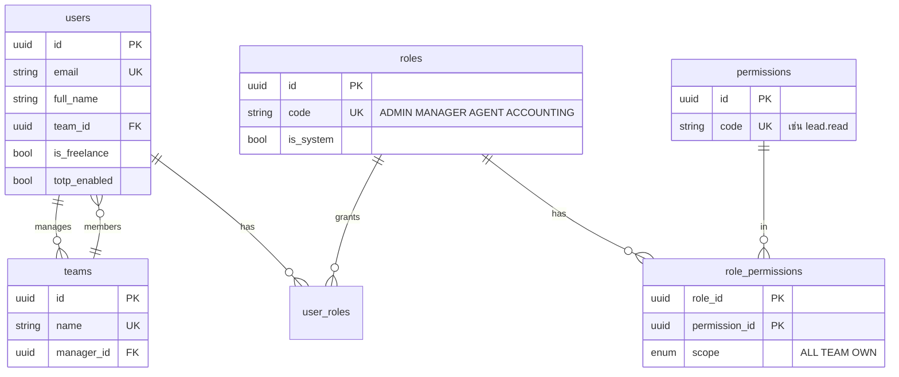
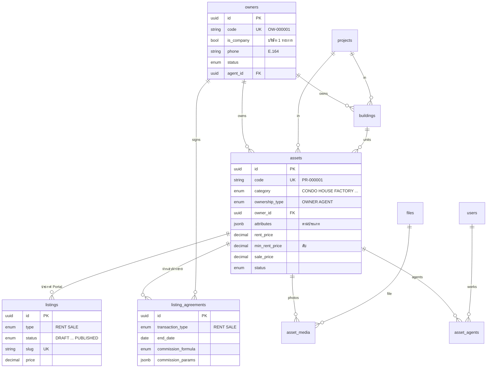
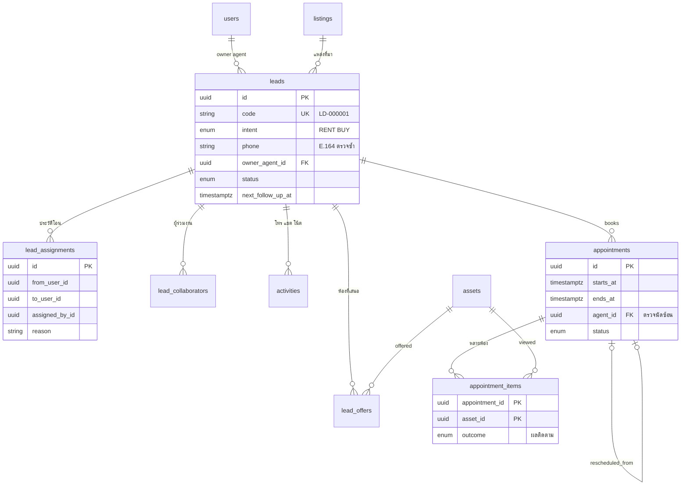
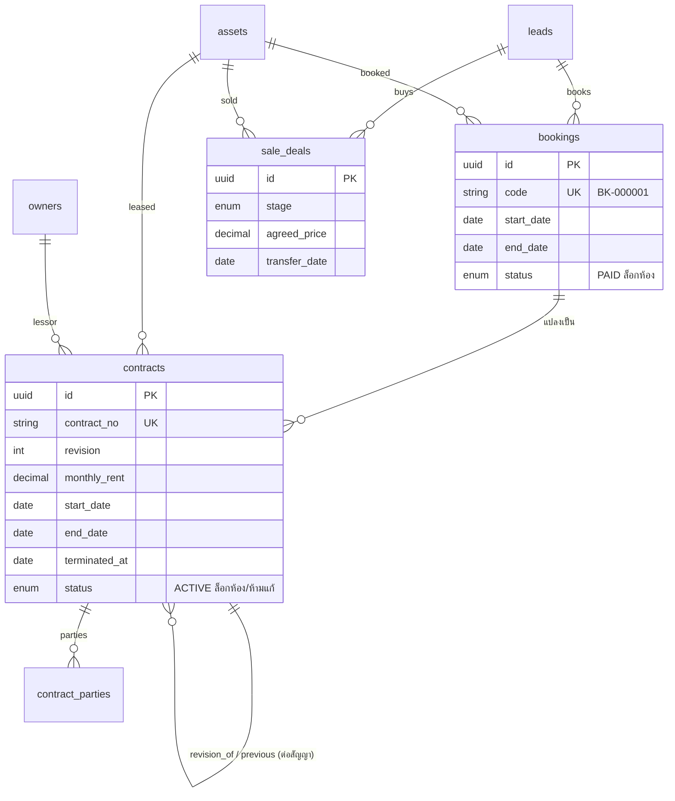
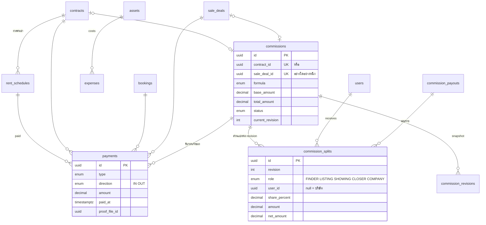

# ERD — โครงสร้างฐานข้อมูล

แหล่งจริงคือ `packages/db/prisma/schema.prisma` และ constraint ที่ Prisma เขียนไม่ได้อยู่ใน `packages/db/prisma/migrations/20261019000100_constraints/migration.sql`
แผนภาพนี้แสดงเฉพาะตารางและความสัมพันธ์หลัก (ไม่รวมคอลัมน์ audit: created_by_id, updated_by_id, archived_at, archived_by_id)

## 1. ผู้ใช้และสิทธิ์

## 2. เจ้าของ ทรัพย์สิน ประกาศ

## 3. CRM และนัดหมาย

## 4. จอง สัญญา ขาย

## 5. การเงินและค่านายหน้า

## 6. ระบบ

`files` (ไฟล์ทุกชนิด, polymorphic entity_type/entity_id), `notifications`, `notification_rules`, `audit_logs` (append-only), `code_sequences` (เลขรัน)

## Constraint สำคัญในฐานข้อมูล

| ชื่อ | ตาราง | กฎ |
| --- | --- | --- |
| `bookings_no_overlap` | bookings | จองที่ PAID ห้ามช่วงวันที่ทับกันบนห้องเดียวกัน (EXCLUDE gist) |
| `contracts_no_overlap` | contracts | สัญญา PENDING_SIGNATURE/ACTIVE ห้ามทับกัน คิดถึงวันยกเลิกก่อนกำหนด |
| `asset_period_overlap` | bookings, contracts | trigger ตรวจข้ามตาราง จอง ↔ สัญญา พร้อม advisory lock ต่อห้อง |
| `contract_locked` | contracts | สัญญาที่มีผล/ปิดแล้ว ห้ามแก้เนื้อหา ต้องสร้าง revision ใหม่ |
| `append_only` | audit_logs, commission_revisions | ห้าม UPDATE/DELETE/TRUNCATE |
| `owners_single_company` | owners | มีเจ้าของประเภทบริษัทได้รายการเดียว |
| `commissions_single_source` | commissions | ผูกสัญญาหรือดีลขายอย่างใดอย่างหนึ่งพอดี |
| `commission_splits_*` | commission_splits | % 0–100, แถวบริษัทไม่มี user, net = amount − ภาษี |
| CHECK อื่น ๆ | หลายตาราง | ยอดเงินไม่ติดลบ, วันสิ้นสุด ≥ วันเริ่ม, attributes เป็น object |
